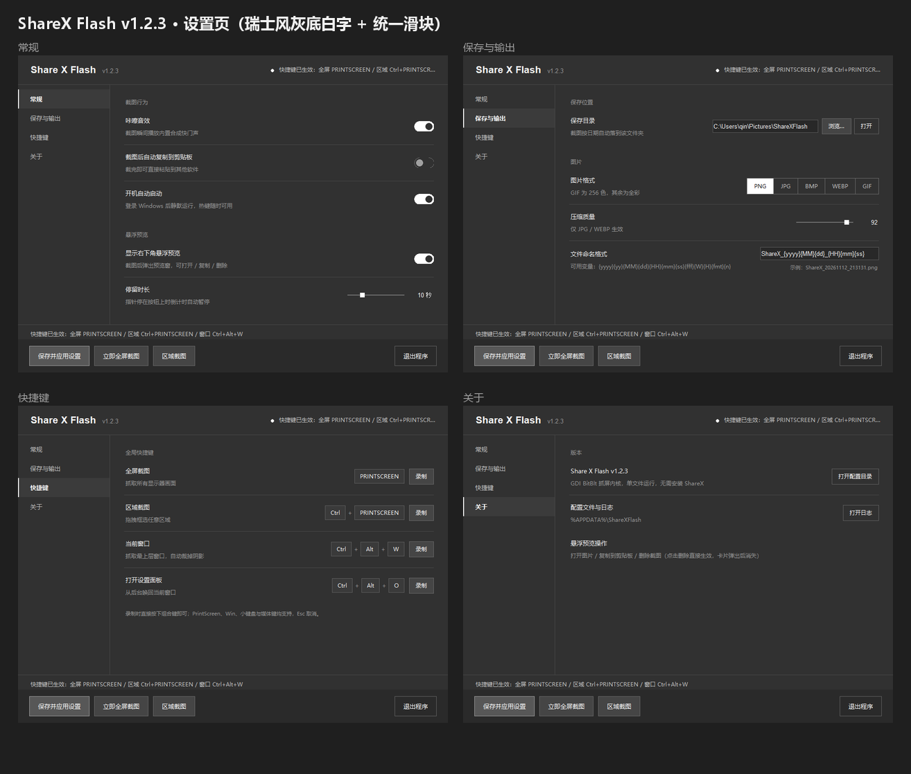
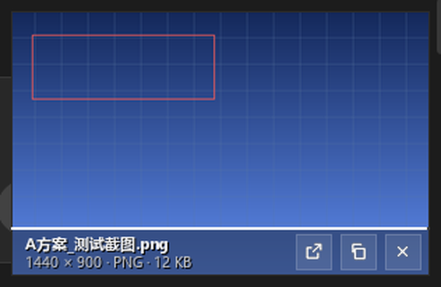

---
AIGC:
    Label: "1"
    ContentProducer: 001191440300708461136T1XGW3
    ProduceID: fdb00e3af3e9d364d870c4a019017ca0_2df2ca36dfe111f189bc525400248c00
    ReservedCode1: 38/9ACiApM8RcSH8T+HtqPWT8uj3n7S3sBFkRTqgMfef8hub8EEE/w0arxjboj34F/IUaw4rt9/Y72fCBiCr+mq7xT//wo6g/LJs/MbZhU22TsjbwgiIk1EFRawAAumwcEx61wFaq8VN0HIFuzzheGuNuFudLVAYNtw9RtW8rNaRQNEN3CVUO+7IcMA=
    ContentPropagator: 001191440300708461136T1XGW3
    PropagateID: fdb00e3af3e9d364d870c4a019017ca0_2df2ca36dfe111f189bc525400248c00
    ReservedCode2: 38/9ACiApM8RcSH8T+HtqPWT8uj3n7S3sBFkRTqgMfef8hub8EEE/w0arxjboj34F/IUaw4rt9/Y72fCBiCr+mq7xT//wo6g/LJs/MbZhU22TsjbwgiIk1EFRawAAumwcEx61wFaq8VN0HIFuzzheGuNuFudLVAYNtw9RtW8rNaRQNEN3CVUO+7IcMA=
---

# Share X Flash

Windows 截图 + 录屏工具，当前版本 **v1.4.0**。

- 截图后端：GDI `BitBlt` / `CopyFromScreen`（经 Pillow `ImageGrab`），支持多显示器与 Per-Monitor V2 高 DPI，不依赖 ShareX 本体
- 录屏后端：以**独立进程**调用 OBS Studio，通过 obs-websocket v5 协议下发采集/编码/开始停止指令；OBS 不在本仓库内，由 `tools/fetch_obs.py` 拉取官方便携版
- 界面：Python 标准库 Tkinter
- 运行依赖：Pillow、websocket-client
- 许可证：本项目 **MIT**；OBS Studio 为 GPL-2.0，只以独立进程 + 独立目录聚合调用，不链接、不再分发其源码，因此不构成衍生作品

## 截图







## 录屏

录屏不是本程序自己写的采集器，而是**把 OBS 当成外部录制引擎**：`sharexflash.py` 负责 UI 与热键，`obs_recorder.py` 负责拉起 OBS、写入参数、开始/暂停/停止，并把 OBS 回传的文件路径接回状态栏。

首次使用：

```bash
python tools/fetch_obs.py     # 从 obsproject/obs-studio 官方 release 拉便携版到 third_party/obs-portable
```

之后按 `Ctrl+Alt+R`（默认）即可录制，`Ctrl+Alt+P` 暂停/继续；停止时 OBS 封装完文件、路径回到状态栏。

- 采集目标：任意显示器，或「跟随鼠标」（多屏笔记本按当前焦点屏录制）
- 分辨率：跟随屏幕原始分辨率，或固定 1080p / 1440p / 2160p
- 帧率：30 / 60 fps
- 编码：自动（交给 OBS 选）/ NVENC / QSV / AMF / x264
- 格式：混合 MP4（断录可恢复） / MP4 / MKV
- 声音：系统声音 / 麦克风 / 两者混音 / 静音——由 OBS 的 WASAPI 采集与混音
- 交互：0–10 秒开始倒计时、录制中暂停/继续、可选悬浮控制条（OBS 无法排除自身浮窗，开启后会录进画面）
- 隔离：内置 OBS 以 `--portable` 运行，配置与场景写在 `third_party/obs-portable` 内，不碰用户自己安装的 OBS 配置；首次启动前自动预写 `user.ini`、obs-websocket 配置与专用 profile，跳过向导、开启本机 WebSocket，并清掉上次异常退出留下的 `.sentinel` 标记（否则 OBS 会停在崩溃恢复对话框上）
- 端口：从 4455 起找空闲端口，避免和你自己开着的 OBS 抢端口；退出时先请求 OBS 正常关闭，超时才强制结束
- 分辨率与帧率通过 obs-websocket 的 `SetVideoSettings` 直接改画布——写 ini 不生效，OBS 只在退出时回写配置

体积参考：OBS 33.0.1 的 Windows x64 便携包约 **213 MB**（解压后实测约 **549 MB**）。仓库不提交它（`.gitignore` 已排除 `third_party/`），需要时按需下载。

## 功能

- 三种截图方式：全屏 / 区域 / 当前窗口
- 全局热键支持任意多键组合，含 PrintScreen、Win、小键盘与媒体键
- 区域框选实时显示选区尺寸，`Esc` 取消
- 窗口截图自动识别最上层窗口并裁掉阴影边缘
- 截图后右下角悬浮预览，置顶显示，可覆盖全屏应用，停留时长 3–30 秒
- 悬浮窗三按钮（打开 / 复制 / 删除）为纯图标，叠加在图片内部，信息条半透明模糊
- 删除无确认框，点击即删文件，预览卡片播放回弹放大 → 收缩淡出
- 倒计时基于 `time.monotonic()` 单调时钟，指针停在按钮上暂停、移出恢复
- 输出可配：保存目录、图片格式（PNG / JPG / BMP / WEBP / GIF）、质量 30–100、文件名模板
- 快门音效由代码合成，运行期写入 `shutter.wav`
- 单实例运行：互斥名 `Local\ShareXFlash_SingleInstance`
- 配置迁移：旧版 `QuickShot` 目录配置自动复制到 `ShareXFlash`
- 高 DPI：Per-Monitor V2，高分屏下截取物理像素
- 录屏一键开始/停止：热键触发，OBS 采集 + 硬件编码，输出 MP4 / MKV
- 录屏可配：显示器（含跟随鼠标）、分辨率、帧率、画质、编码器、格式、声音来源
- 录屏交互：开始倒计时、暂停/继续、可选悬浮控制条、退出程序时自动停止并封装

## 系统要求

| 项目 | 要求 |
| --- | --- |
| 操作系统 | Windows 10 / Windows 11（依赖 Win32 API 与 GDI 抓屏） |
| 运行 exe | 无需 Python 环境 |
| 从源码运行 / 构建 | Python 3.9+ |
| 录屏 | 需 OBS Studio（建议用 `tools/fetch_obs.py` 下载的内置便携版，也可在设置里指定已安装的 `obs64.exe`） |

## 快速开始

运行 `release\ShareX Flash.exe`，免安装。程序常驻后台，用快捷键截图。

想用录屏，先准备 OBS 便携版（只需一次）：

```bash
python tools/fetch_obs.py
```

从源码运行：

```bash
pip install -r requirements.txt
python tools/fetch_obs.py
python src/sharexflash.py
```

### 默认快捷键

| 快捷键 | 功能 |
| --- | --- |
| `Ctrl+Alt+A` | 全屏截图（抓取所有显示器画面） |
| `Ctrl+Alt+S` | 区域截图（拖拽框选） |
| `Ctrl+Alt+W` | 当前窗口截图（最上层窗口，自动裁阴影） |
| `Ctrl+Alt+R` | 开始 / 停止录屏 |
| `Ctrl+Alt+P` | 暂停 / 继续录屏 |
| `Ctrl+Alt+L` | 进出讲解师模式（录制中冻结画面做批注，默认值，可改） |
| `Ctrl+Alt+O` | 打开设置面板 |

快捷键可在设置面板「快捷键」页签重新录制，支持任意多键组合与 PrintScreen 等单键，录制时 `Esc` 取消。上表是出厂默认值，实际生效的是设置页保存的组合（`config.json` 的 `hotkey_*` 字段）。

## 文件路径

| 用途 | 路径 |
| --- | --- |
| 配置文件 | `%APPDATA%\ShareXFlash\config.json` |
| 运行日志 | `%APPDATA%\ShareXFlash\sharexflash.log` |
| 音效文件 | `%APPDATA%\ShareXFlash\shutter.wav`（首次播放时合成） |
| 截图保存目录 | `%USERPROFILE%\Pictures\ShareXFlash`（可修改） |
| 录制保存目录 | 默认为上一条同目录下的 `Recordings\`，可在「录屏」页签单独指定 |
| OBS 便携版 | `third_party\obs-portable\`（由 `tools/fetch_obs.py` 下载，OBS 自身的配置也写在这里） |

配置字段：`hotkey_full`、`hotkey_region`、`hotkey_window`、`hotkey_panel`、`hotkey_record`、`hotkey_recpause`、`hotkey_lecturer`、`save_dir`、`image_format`、`quality`、`name_template`、`sound_enabled`、`auto_copy`、`preview_enabled`、`preview_seconds`、`autostart`，以及录屏相关：
`rec_dir`、`rec_monitor`（`-1` 表示跟随鼠标）、`rec_resolution`、`rec_fps`、`rec_quality`、`rec_encoder`、`rec_format`、`rec_audio`、`rec_countdown`、`rec_cursor`、`rec_hud`、`rec_lecturer`、`rec_obs_path`。

## 设置项

五个页签，修改后点击底部「保存并应用设置」生效。

### 常规

| 设置项 | 说明 |
| --- | --- |
| 咔嚓音效 | 截图瞬间播放合成快门声 |
| 截图后自动复制到剪贴板 | 截完可直接粘贴 |
| 开机自动启动 | 写入 `HKCU\Software\Microsoft\Windows\CurrentVersion\Run` |
| 显示右下角悬浮预览 | 截图后弹出预览窗 |
| 停留时长 | 3–30 秒，指针停在按钮上时暂停倒计时 |

### 保存与输出

| 设置项 | 说明 |
| --- | --- |
| 保存目录 | 截图保存位置，可浏览选择或打开 |
| 图片格式 | PNG / JPG / BMP / WEBP / GIF 分段选择（GIF 为 256 色） |
| 压缩质量 | 30–100，仅 JPG / WEBP 生效 |
| 文件命名格式 | 变量：`{yyyy}` `{yy}` `{MM}` `{dd}` `{HH}` `{mm}` `{ss}` `{fff}` `{W}` `{H}` `{fmt}` `{n}`；实时预览，同名自动追加序号 |

### 录屏

| 设置项 | 说明 |
| --- | --- |
| 后端状态 | 显示定位到的 OBS 路径与来源（内置便携版 / 系统安装），可「指定路径」手动选择 `obs64.exe` |
| 采集目标 | 选显示器或「跟随鼠标」；多屏按坐标匹配 OBS 的显示器列表，避免顺序错位 |
| 分辨率 | 跟随屏幕（原始分辨率）/ 1080p / 1440p / 2160p，奇数边会自动修正为偶数 |
| 帧率 | 30 / 60 fps |
| 画质 | 标准 / 高 / 近乎无损（对应 OBS 简化输出档位） |
| 编码器 | 自动 / NVENC / QSV / AMF / x264 |
| 文件格式 | 混合 MP4（断录可恢复）/ MP4 / MKV |
| 声音 | 系统声音 / 麦克风 / 两者混音 / 静音 |
| 录制目录 | 留空则落在保存目录下的 `Recordings` |
| 开始倒计时 | 关闭 / 3 / 5 / 10 秒 |
| 录制鼠标指针 | 教程类录屏建议开启 |
| 悬浮控制条 | 录制时显示计时与暂停/停止；OBS 无法排除自身浮窗，开启后会被录进画面 |
| 讲解师模式 | 开启后可在录制中按热键冻结画面做批注（详见下节） |

录制过程中，状态栏会持续显示计时；OBS 若在外部被停止（崩溃或手动点停止），程序会自动收尾并提示。

### 讲解师模式

适合边讲边录的教程 / 网课：录制中按热键（默认 `Ctrl+Alt+L`）把当前那一帧冻成整屏画布，讲完再按同一个键回到实时画面。因为 OBS 一直在录这块屏，画布上的操作会直接进成片，不用后期补录或剪辑。

| 操作 | 效果 |
| --- | --- |
| 左键拖动 | 平移画布（放大后才看得出移动） |
| 滚轮 | 以光标为锚点缩放，0.5x–5x |
| 左 Alt + 左键 | 重点标记：黑边从四周向点位收拢 0.5s，点位高亮、其余压暗停留 1.2s，0.2s 内撤掉 |
| 同一个热键 / `Esc` | 退出讲解师模式，回到实时画面 |

不进这个画布也能标重点：录制中（含暂停）直接按住 `左 Alt + 左键`，会临时盖一层透明、鼠标穿透、不抢焦点的置顶叠加层，在真实画面上做同一套收拢 / 停留 / 消失动画，圈内透出桌面原样（约 60fps），2 秒后自动消失。它同样会被 OBS 录进成片。

画布按「视口」渲染：任何缩放倍率下都只计算屏幕那么大的一张图，不会因为放大 5 倍就去生成一张两三万像素的大图。

后台的 OBS 用独立进程启动，主窗口由程序持续压成隐藏：录制时不会弹出 OBS 界面、不占任务栏，也不在托盘里留图标（`user.ini` 里的 `SysTrayEnabled` 每次启动都会压成 false）。

开录与结束各有一次屏幕边框反馈：按下开始键的当口，被录那块屏四周亮一圈 16px 绿光；结束并封装完成时亮一圈红光；先亮 450ms 再淡出 550ms，约 1 秒。绿光刻意落在真正开录之前（有倒计时就在倒计时起点，关掉倒计时则延后 1150ms 再开录），所以不会出现在片头；描边窗口鼠标穿透、不进 Alt+Tab。

录完一段同样会弹出右下角预览卡片（和截图一致）：缩略图取开录那一刻的屏幕画面，副标题是 `格式 · 时长 · 大小`，三个按钮分别是打开文件（默认播放器）、复制文件路径、删除。

### 快捷键

八个动作独立录制：全屏 / 区域 / 当前窗口 / 开始录屏 / 结束录屏 / 暂停继续录屏 / 讲解师模式 / 设置面板。「结束录屏」单独一个键（默认 `PAUSE`），只停不误开。录完一个组合就立即生效并写盘（不用再点「保存并应用设置」），注册失败的热键会在状态栏说明原因；每次触发都会写进日志，便于排查。

### 关于

查看版本、打开配置目录、查看日志。

## 构建

```bat
build.bat
```

等价命令：

```bash
pip install -r requirements.txt pyinstaller
pyinstaller --noconfirm --clean --onefile --noconsole --icon assets/sharexflash.ico \
  --add-data "assets/sharexflash.ico;." \
  --hidden-import obs_recorder --hidden-import gdi_canvas --hidden-import spot_overlay \
  --hidden-import websocket --hidden-import websocket._core \
  --paths "src" \
  --name "ShareX Flash" --distpath dist --workpath build src/sharexflash.py
```

产物输出到 `dist\ShareX Flash.exe`。`build.bat` 以自身所在目录为基准，需在项目根目录执行以复用 `assets\` 与 `src\` 路径。

OBS 不打进 exe：exe 仍然很小，录屏能力由 `third_party\obs-portable` 或系统已装的 OBS 提供。如需一次性分发，可把 exe 与 `obs-portable` 目录一起打包成安装器（约 220 MB）。

## 目录结构

```text
ShareX-Flash/
├── src/
│   ├── sharexflash.py            # 截图主程序 + UI + 热键 + 录屏流程编排
│   ├── gdi_canvas.py             # 讲解师画布引擎：GDI 双缓冲、笔栏批注、重点高亮
│   ├── spot_overlay.py           # 录制中的聚光灯叠加层（不冻屏也能标重点）
│   └── obs_recorder.py           # OBS 后端：obs-websocket v5 客户端 + 进程/场景/音频控制
├── tools/
│   └── fetch_obs.py              # 下载 OBS 官方便携版到 third_party
├── third_party/
│   └── obs-portable/             # 下载产物，不进仓库（.gitignore 已排除）
├── assets/
│   └── sharexflash.ico           # 应用图标
├── docs/
│   ├── screenshot-settings.png
│   ├── screenshot-float.png
│   ├── screenshot-float-default.png
│   └── screenshot-delete.png
├── release/
│   └── ShareX Flash.exe          # 可执行文件
├── build.bat
├── requirements.txt
├── CHANGELOG.md
├── LICENSE
└── README.md
```

## License

[MIT](LICENSE)
*（内容由AI生成，仅供参考）*

