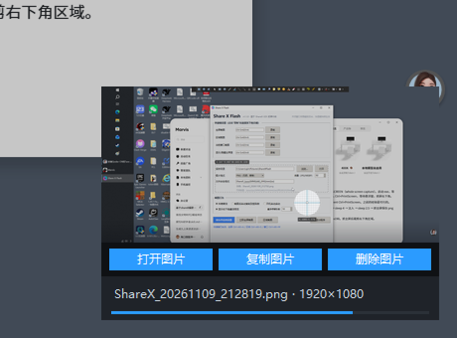
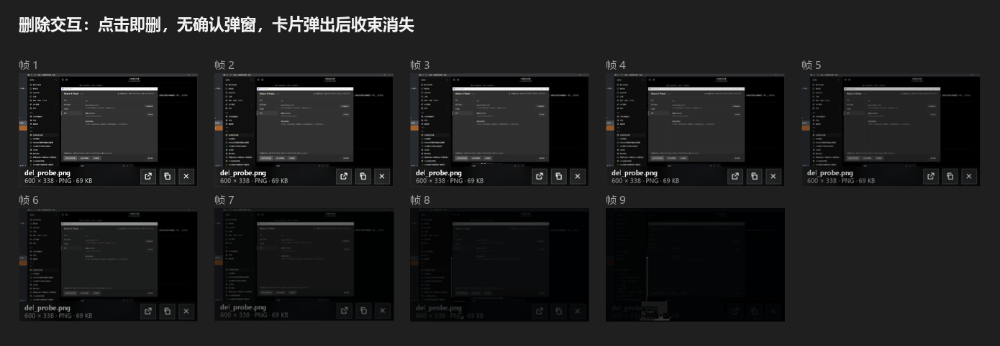

---
AIGC:
    Label: "1"
    ContentProducer: 001191440300708461136T1XGW3
    ProduceID: fdb00e3af3e9d364d870c4a019017ca0_2df2ca36dfe111f189bc525400248c00
    ReservedCode1: 38/9ACiApM8RcSH8T+HtqPWT8uj3n7S3sBFkRTqgMfef8hub8EEE/w0arxjboj34F/IUaw4rt9/Y72fCBiCr+mq7xT//wo6g/LJs/MbZhU22TsjbwgiIk1EFRawAAumwcEx61wFaq8VN0HIFuzzheGuNuFudLVAYNtw9RtW8rNaRQNEN3CVUO+7IcMA=
    ContentPropagator: 001191440300708461136T1XGW3
    PropagateID: fdb00e3af3e9d364d870c4a019017ca0_2df2ca36dfe111f189bc525400248c00
    ReservedCode2: 38/9ACiApM8RcSH8T+HtqPWT8uj3n7S3sBFkRTqgMfef8hub8EEE/w0arxjboj34F/IUaw4rt9/Y72fCBiCr+mq7xT//wo6g/LJs/MbZhU22TsjbwgiIk1EFRawAAumwcEx61wFaq8VN0HIFuzzheGuNuFudLVAYNtw9RtW8rNaRQNEN3CVUO+7IcMA=
---

# Share X Flash

Windows 截图工具，当前版本 **v1.2.3**。

- 抓屏后端：GDI `BitBlt` / `CopyFromScreen`（经 Pillow `ImageGrab`），支持多显示器与 Per-Monitor V2 高 DPI，不依赖 ShareX 本体
- 界面：Python 标准库 Tkinter
- 运行依赖：Pillow（唯一第三方依赖）

## 截图







## 功能

- 三种截图方式：全屏 / 区域 / 当前窗口
- 全局热键支持任意多键组合，含 PrintScreen、Win、小键盘与媒体键
- 区域框选实时显示选区尺寸，`Esc` 取消
- 窗口截图自动识别最上层窗口并裁掉阴影边缘
- 截图后右下角悬浮预览，置顶显示，可覆盖全屏应用，停留时长 3–30 秒
- 悬浮窗三按钮（打开 / 复制 / 删除）为纯图标，叠加在图片内部，信息条半透明模糊
- 删除无确认框，点击即删文件，预览卡片播放回弹放大 → 收缩淡出
- 倒计时基于 `time.monotonic()` 单调时钟，指针停在按钮上暂停、移出恢复
- 输出可配：保存目录、图片格式（PNG / JPG / BMP / WEBP / GIF）、质量 30–100、文件名模板
- 快门音效由代码合成，运行期写入 `shutter.wav`
- 单实例运行：互斥名 `Local\ShareXFlash_SingleInstance`
- 配置迁移：旧版 `QuickShot` 目录配置自动复制到 `ShareXFlash`
- 高 DPI：Per-Monitor V2，高分屏下截取物理像素

## 系统要求

| 项目 | 要求 |
| --- | --- |
| 操作系统 | Windows 10 / Windows 11（依赖 Win32 API 与 GDI 抓屏） |
| 运行 exe | 无需 Python 环境 |
| 从源码运行 / 构建 | Python 3.9+ |

## 快速开始

运行 `release\ShareX Flash.exe`，免安装。程序常驻后台，用快捷键截图。

从源码运行：

```bash
pip install -r requirements.txt
python src/sharexflash.py
```

### 默认快捷键

| 快捷键 | 功能 |
| --- | --- |
| `Ctrl+Alt+A` | 全屏截图（抓取所有显示器画面） |
| `Ctrl+Alt+S` | 区域截图（拖拽框选） |
| `Ctrl+Alt+W` | 当前窗口截图（最上层窗口，自动裁阴影） |
| `Ctrl+Alt+O` | 打开设置面板 |

快捷键可在设置面板「快捷键」页签重新录制，支持任意多键组合与 PrintScreen 等单键，录制时 `Esc` 取消。

## 文件路径

| 用途 | 路径 |
| --- | --- |
| 配置文件 | `%APPDATA%\ShareXFlash\config.json` |
| 运行日志 | `%APPDATA%\ShareXFlash\sharexflash.log` |
| 音效文件 | `%APPDATA%\ShareXFlash\shutter.wav`（首次播放时合成） |
| 截图保存目录 | `%USERPROFILE%\Pictures\ShareXFlash`（可修改） |

配置字段：`hotkey_full`、`hotkey_region`、`hotkey_window`、`hotkey_panel`、`save_dir`、`image_format`、`quality`、`name_template`、`sound_enabled`、`auto_copy`、`preview_enabled`、`preview_seconds`、`autostart`。

## 设置项

四个页签，修改后点击底部「保存并应用设置」生效。

### 常规

| 设置项 | 说明 |
| --- | --- |
| 咔嚓音效 | 截图瞬间播放合成快门声 |
| 截图后自动复制到剪贴板 | 截完可直接粘贴 |
| 开机自动启动 | 写入 `HKCU\Software\Microsoft\Windows\CurrentVersion\Run` |
| 显示右下角悬浮预览 | 截图后弹出预览窗 |
| 停留时长 | 3–30 秒，指针停在按钮上时暂停倒计时 |

### 保存与输出

| 设置项 | 说明 |
| --- | --- |
| 保存目录 | 截图保存位置，可浏览选择或打开 |
| 图片格式 | PNG / JPG / BMP / WEBP / GIF 分段选择（GIF 为 256 色） |
| 压缩质量 | 30–100，仅 JPG / WEBP 生效 |
| 文件命名格式 | 变量：`{yyyy}` `{yy}` `{MM}` `{dd}` `{HH}` `{mm}` `{ss}` `{fff}` `{W}` `{H}` `{fmt}` `{n}`；实时预览，同名自动追加序号 |

### 快捷键

四个动作独立录制：全屏 / 区域 / 当前窗口 / 设置面板。保存时尝试注册全局热键，失败项在状态栏提示原因。

### 关于

查看版本、打开配置目录、查看日志。

## 构建

```bat
build.bat
```

等价命令：

```bash
pip install -r requirements.txt pyinstaller
pyinstaller --noconfirm --clean --onefile --noconsole --icon assets/sharexflash.ico --name "ShareX Flash" --distpath dist --workpath build src/sharexflash.py
```

产物输出到 `dist\ShareX Flash.exe`。`build.bat` 以自身所在目录为基准，需在项目根目录执行以复用 `assets\` 与 `src\` 路径。

## 目录结构

```text
ShareX-Flash/
├── src/
│   └── sharexflash.py            # 全部程序逻辑（单文件）
├── assets/
│   └── sharexflash.ico           # 应用图标
├── docs/
│   ├── screenshot-settings.png
│   ├── screenshot-float.png
│   ├── screenshot-float-default.png
│   └── screenshot-delete.png
├── release/
│   └── ShareX Flash.exe          # v1.2.3 可执行文件
├── build.bat
├── requirements.txt
├── CHANGELOG.md
├── LICENSE
└── README.md
```

## License

[MIT](LICENSE)
*（内容由AI生成，仅供参考）*
